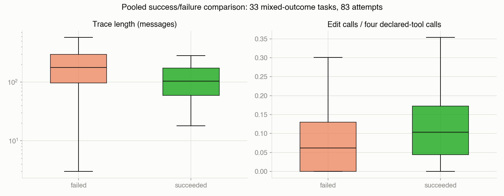

# Coding-Agent Behaviour and Evaluation Reliability

### An empirical study of execution traces

**370 attempts · 253 tasks · 7 anonymized model labels · 15 jobs**

[Read the research study](docs/STUDY.md) · [Explore the computational notebook](agent_traces_analysis.ipynb) · [Data and provenance](docs/DATA.md) · [Python pipeline](#automated-python-pipeline) · [Reproduce](#reproduce-the-study)

## Research overview

What do execution traces reveal about coding-agent behaviour, and which conclusions depend on the design of the evaluation itself?

This empirical study follows coding-agent attempts from nested execution records to interpretable evidence. It combines a structural audit, linked message/action/request tables, behavioural comparisons, task-grouped retrospective classification, and an examination of coverage and run conditions. The contribution is an account of observed performance and its measurement: where traces contain useful information, where intuitive signals are weak, and what better evaluations need to record and control.

The analysis uses the public [mfmVNfpt2q/agent-traces](https://huggingface.co/datasets/mfmVNfpt2q/agent-traces) dataset. A pinned revision and byte-verified Arrow snapshot identify the analyzed population. Model labels are anonymized; success refers to recorded `OK`, with the grader implementation unavailable. Findings are scoped to this observational collection.

## Questions and contributions

| Research question | Contribution |
|---|---|
| **What does the evaluation design allow us to compare?** | Coverage and repeat analysis separates observed rates from same-task job contrasts and exposes unequal assignment. |
| **How do recorded behaviours differ across outcomes?** | Linked tables characterize activity, tool allocation, trace endpoints, request statuses, and selected cases. |
| **Which summaries contain outcome information?** | Existing task-grouped classifiers and targeted signal checks establish both useful associations and weak results. |

The [research study](docs/STUDY.md) develops the argument through an abstract, methods, results, cases, discussion, and limitations. The [notebook](agent_traces_analysis.ipynb) supplies all 84 executable analysis cells, complete outputs, and the exploration record.

## Selected findings

### Evaluation conditions matter to observed performance

Raw model success rates span **35.0–88.3%**, but task assignment is unequal. Restricting to 79 multi-model tasks still leaves each label with a different task set and repeat weights. A more focused comparison finds **17/18 versus 10/18 successes** for cyan on common tasks across two jobs. Task identity is held fixed, while job, role convention, and embedded date co-vary; the cause remains unresolved.

Of 26 repeated model/task groups, eight disagree on outcome. Twenty-five groups span jobs, and seven disagreements are the cyan flips. The result describes predominantly cross-job variation rather than randomness under identical conditions.

### Completed traces contain outcome information

Existing classifiers achieve task-grouped cross-validated **AUCs of 0.699–0.762** using completed-trace summaries, configuration, and model identity. On 33 multi-model tasks with mixed outcomes, pooled successes have a median **104.5 messages**, compared with **177.0** for pooled failures, and larger median edit fractions. These are retrospective associations; task filtering does not balance the pooled comparison.



*Figure 1. Activity and edit allocation for 83 attempts on 33 mixed-outcome tasks. Boxes show medians and interquartile ranges; outliers are hidden and message count uses a logarithmic axis. The comparison remains sensitive to task, model, and job composition. [Methods and interpretation](docs/STUDY.md#43-activity-patterns-differ-by-outcome-with-substantial-overlap).*

### Weak signals and measurement gaps are substantive findings

First-order tool transitions look similar across outcomes. A fixed closing-language rule flags success phrases in about **49% of OK** and **54% of WA** attempts with text. Prompt length has near-zero linear association with success (**r=0.023**). These findings limit simple shortcuts without ruling out richer representations.

Count reconciliation passes, while occurrence-aware ID checks find **13 orphan results, 62 unanswered calls, and one reused ID**, affecting 67 traces. Fifty unanswered calls are terminal. Separately, **90.7% of assistant messages omit `content`**. The distinction between recorded structure and complete execution reconstruction is part of the study's measurement contribution.

## Read and inspect the evidence

| Resource | What it provides |
|---|---|
| **[Research study](docs/STUDY.md)** | Continuous narrative, methods, result tables, selected figures, discussion, references, and evidence map |
| **[Computational notebook](agent_traces_analysis.ipynb)** | Full executable analysis and exploration, with verified outputs |
| [Analysis outputs](analysis_outputs/) | Fifteen figures, concise result tables, dictionaries, findings, and checksummed manifest |
| [Data documentation](docs/DATA.md) and [snapshot identity](data_snapshot.json) | Provenance, pinned acquisition, exact byte identity, and rights scope |
| **[Python pipeline](scripts/run_pipeline.py)** | One-command acquisition or local-data loading, analysis execution, and evidence verification |
| [Helper module](agent_traces_lib.py), [analysis runner](scripts/run_analysis.py), and [tests](tests/) | Parsing, linked tables, fresh-kernel execution, and focused checks |
| [Supporting material](supporting/README.md) | Historical preparation source and artifact dispositions |
| [Review notes](REVIEW_NOTES.md) | Validation evidence and project audit dispositions |

The study relates its evaluation questions to [SWE-bench](https://arxiv.org/abs/2310.06770) and [HELM](https://arxiv.org/abs/2211.09110), without asserting that this dataset belongs to either benchmark. `AUDIT.md` and `PROJECT_PLAN.md` are project records.

## Automated Python pipeline

[`scripts/run_pipeline.py`](scripts/run_pipeline.py) automates the workflow from an explicit Arrow snapshot to verified results. It uses the same Python interpreter for every stage and resolves project scripts independently of the launch directory:

1. Use a local snapshot, or acquire the revision-pinned dataset with `--acquire`.
2. Verify the Arrow checksum and execute all 84 notebook cells in a fresh kernel through `run_analysis.py`.
3. Generate tables, 15 figures, an executed notebook, HTML, and a source/data/artifact manifest.
4. Run `check_review.py` to verify execution order, reconciliation, recorded claims, hashes, and output hygiene.

The notebook is the single computational source; the Python pipeline executes it without manual cell interaction. It stops with a nonzero exit code if a stage fails and refuses populated output directories. [Pipeline methods and outputs](docs/STUDY.md#34-automated-python-analysis-pipeline) are documented in the study.

## Reproduce the study

Use **Python 3.11**; direct dependencies are pinned in [requirements.txt](requirements.txt). The reviewed environment uses Python 3.11.15 on macOS arm64. Acquire the Arrow snapshot using the revision-pinned instructions in [docs/DATA.md](docs/DATA.md), then run:

```sh
python3.11 -m venv .venv
.venv/bin/python -m pip install -r requirements.txt
.venv/bin/python scripts/run_pipeline.py \
  --dataset /path/to/agent-traces-train.arrow \
  --output .local_runs/reproduction
.venv/bin/python -m unittest discover -s tests -v
```

To acquire and analyze in one command, replace `--dataset /path/to/agent-traces-train.arrow` with `--acquire .local_runs/data/agent-traces-train.arrow`; the acquisition target must also be new.

**The output directory must be new or empty.** The pipeline verifies the snapshot checksum, executes all 84 cells in a fresh kernel, and regenerates 15 figures, tables, an executed notebook, an HTML view, and a manifest. It resolves the project root from the script location and works from another directory when invoked by absolute path. After installation and acquisition, analysis runs offline. Saved result tables are never inputs.

The root notebook retains readable outputs. Duplicate executed notebook/HTML products and Parquet checkpoints are ignored locally; regenerate them before running the evidence check, whose manifest includes those products. For interactive use, set `AGENT_TRACES_PROJECT_ROOT`, `AGENT_TRACES_DATASET`, and `AGENT_TRACES_OUTPUT` explicitly before running all cells.

## Scope and data rights

This is an observational study with unequal assignment, shared jobs, repeated tasks, small endpoint groups, and undocumented grader/stop rules. Task-grouped validation separates exact task IDs but does not establish new-job transfer or exclude semantic task overlap. Reported p-values and intervals are exploratory or descriptive. The [study limitations](docs/STUDY.md#7-limitations) explain their consequences.

Original analysis code is covered by the [MIT License](LICENSE), with the notice `Copyright (c) 2026 The project contributors`. This does not relicense the upstream dataset or other third-party material. Raw traces and verbatim prompt, message, tool-description, or argument excerpts are excluded. Readers obtain data directly from Hugging Face under applicable source terms; a dataset-specific redistribution license remains unverified.
