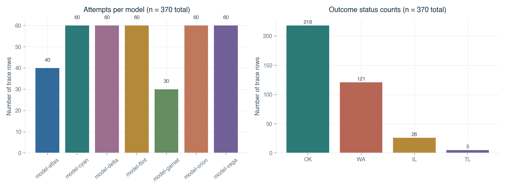
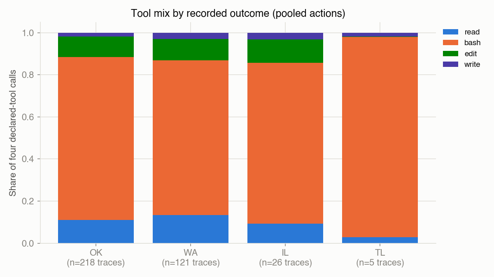
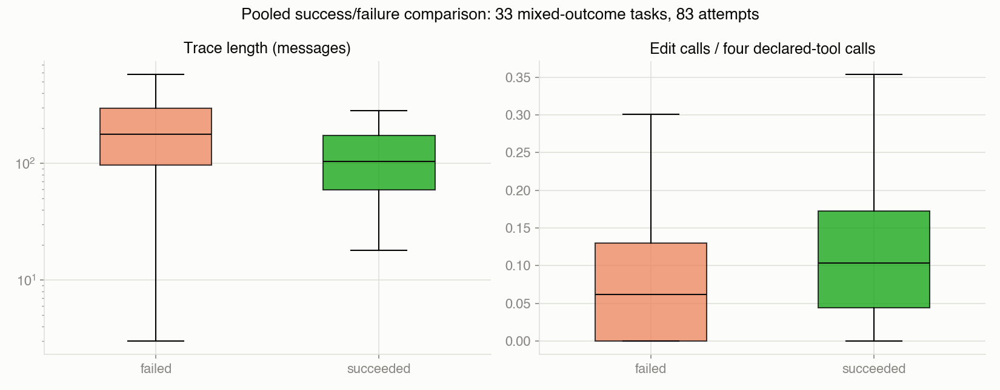

# Coding-Agent Behaviour and Evaluation Reliability

### An empirical study of execution traces

**Research study · November 2026**

[Overview](../README.md) · [Computational notebook](../agent_traces_analysis.ipynb) · [Data and provenance](DATA.md)

## Abstract

Execution traces offer a detailed view of coding agents, but interpreting that detail requires understanding how tasks, runs, outcomes, and recorded actions relate. This study examines 370 attempts on 253 tasks across seven anonymized model labels and 15 jobs. A structural audit and linked representation of messages, tool calls, proxy requests, and outcomes support descriptive comparisons, a task-paired job comparison, and retrospective outcome classification. Raw model success rates span 35.0–88.3%, while incomplete task overlap and unequal repeated measures limit capability comparisons. On 18 common tasks, one model label succeeds on 17 attempts in one job and 10 in another; co-varying run conditions leave the mechanism unresolved. Existing classifiers achieve task-grouped cross-validated AUCs of 0.699–0.762 using completed-trace and configuration summaries. Several intuitive signals are weak: first-order tool transitions show little separation, final-message success keywords occur at similar rates in successful and unsuccessful attempts with text, and prompt length has near-zero linear association with success. An occurrence-aware identifier audit also exposes gaps that count reconciliation alone misses. Together, these results show how trace analysis can characterize observed behaviour and improve evaluation design while preserving the distinction between recorded associations, mechanisms, and generalizable capability.

## 1. Introduction

Coding-agent evaluation produces more than a success label. An attempt can contain hundreds of messages, repeated shell calls, edits, reasoning fields, and a closing summary. These records make it possible to ask how an agent worked, whether unsuccessful attempts followed different processes, and which aspects of execution are associated with the evaluator's decision. They also introduce a measurement problem: the contents of a trace reflect both agent activity and the system that recorded it.

A high success rate may accompany an easier task mix. A long trace may reflect a difficult task, a limit, or an unsuccessful search. A confident closing message may say little about externally assessed correctness. Missing message content may be a serialization convention rather than missing activity. Each interpretation depends on relationships that must be established in the data before the associated statistic becomes useful.

This study addresses three questions:

| Research question | Evidence examined |
|---|---|
| **RQ1. What does the evaluation design allow us to compare?** | Task/model/job coverage, repeated attempts, observed rates, and a same-task comparison across two jobs |
| **RQ2. How do recorded behaviours differ across outcomes?** | Conversation lengths, tool shares, edit fractions, endpoint patterns, proxy statuses, and selected cases |
| **RQ3. Which trace summaries contain outcome information, and what are their limits?** | Task-grouped retrospective classifiers, closing-language heuristics, prompt-length association, and lexical screening |

The contribution is a reproducible empirical account of a particular trace collection: a structural measurement audit, linked analytical tables, behavioural findings, useful negative results, and concrete implications for evaluation design. The study does not introduce a new benchmark or identify the anonymized systems.

### Research context

SWE-bench frames real GitHub issue resolution as an executable software-engineering evaluation problem, motivating attention to repository interaction and observed task outcomes. HELM emphasizes transparent evaluation across scenarios and metrics under standardized conditions. These perspectives motivate the present focus on behaviour, coverage, and measurement. Neither reference establishes the origin of this dataset or the identity of its grader. [Jimenez et al., 2024](https://arxiv.org/abs/2310.06770); [Liang et al., 2023](https://arxiv.org/abs/2211.09110).

## 2. Data and measurement

### 2.1 Evaluation population

The analysis uses the public Hugging Face dataset [mfmVNfpt2q/agent-traces](https://huggingface.co/datasets/mfmVNfpt2q/agent-traces), pinned to revision `1be8b9a763288ba2a4efbf8c354bc66cffa50368`. The analyzed Arrow snapshot contains 370 rows; its checksum and acquisition procedure are recorded in [the data documentation](DATA.md). Raw traces and verbatim excerpts are excluded from this repository.

| Dimension | Observed population |
|---|---:|
| Recorded attempts | 370 |
| Distinct task IDs | 253 |
| Anonymized model labels | 7 |
| Jobs | 15 |
| Repository families derived from task IDs | 77 |
| Tasks with one attempt | 161 |
| Tasks with repeated attempts | 92 |
| Tasks attempted by multiple model labels | 79 |

An attempt is the primary observation. A task can recur across models or jobs, while each job maps to one model label. Trial IDs are unique opaque labels. Repeated task IDs carry identical observed user-prompt text, supporting task-ID grouping within this snapshot. Dates embedded in prompts are recorded strings; they are not verified execution timestamps.

The outcome variable is the recorded status. `OK` occurs 218 times, `WA` 121, `IL` 26, and `TL` five. Binary reward is exactly the indicator for `OK`, so it supplies no additional outcome information. Throughout this study, success means recorded `OK`; the evaluator implementation and independent patch-correctness checks are unavailable. IL and TL are retained as labels because their triggering rules are undocumented.



*Figure 1. Unequal model sample sizes and the four recorded outcome categories. Five labels have 60 attempts, atlas has 40, and garnet has 30. Overall success is 218/370. Small IL and especially TL groups constrain interpretation of status-specific patterns. Source: notebook Sections 7–8.*

### 2.2 Linked representation

Nested records are represented at their natural grains: attempts, messages, tool calls, proxy requests, and offered tool definitions. Every derived base table retains the positional `row_id`; message and call indices preserve ordering. Task and model aggregates are constructed from these tables. This representation allows a claim about an attempt to be traced back to its contributing observations without conflating message counts, action counts, and request counts.

The four declared tools are `read`, `bash`, `edit`, and `write`. Tool names identify interfaces, not the semantic activity inside a command. For example, a shell call can inspect code, run tests, or modify a file. Proxy records contain HTTP-style statuses without timestamps, endpoints, or a shared action identifier. Consequently, proxy requests cannot be joined to individual tool actions on evidence supplied by this dataset.

### 2.3 Transcript integrity

Five count and metadata reconciliation checks pass, but a separate occurrence-aware identifier audit finds 13 orphan results, 62 unanswered calls, and one reused call ID, affecting 67 traces. Of the unanswered calls, 50 occur in the last recorded message and 12 occur earlier. No ordering violations are detected among the paired occurrences checked. These categories distinguish an unanswered terminal action from an unexplained internal gap; they do not establish why either occurred.

Additionally, 90.7% of assistant messages omit the `content` key. The parser handles missing keys explicitly and summarizes reasoning fields structurally. The recorded presence or length of reasoning text is not treated as a measure of reasoning quality. Eighteen unrecognized call names occur in 13 traces and remain flagged rather than repaired. Eight traces end on a tool message without a subsequent assistant turn. These findings set the limits of process reconstruction while leaving scalar and count analyses useful.

## 3. Analytical approach

### 3.1 Descriptive comparisons and weighting

Model success rates average observed attempts. Restricting analysis to tasks attempted by multiple models changes the population but leaves unequal coverage and repeat weighting. Repository-family summaries describe outcome heterogeneity rather than causal difficulty. A paired analysis is used only for the existing cyan comparison, where the same 18 task IDs occur in two jobs.

Behavioural summaries distinguish pooled action shares from per-attempt distributions. In a pooled tool mix, a long trace contributes more calls. A per-trace edit fraction gives each attempt its own ratio, with the denominator restricted to the four declared tools. Means and medians are both considered for heavy-tailed counts. These choices answer different descriptive questions and are reported explicitly.

A further comparison pools successes and failures among 33 multi-model tasks with mixed observed outcomes. It retains 83 attempts. Selecting this population makes the comparison more relevant to tasks with outcome variation, but it does not balance task weights or estimate a within-task effect.

### 3.2 Retrospective classification

The binary target is recorded success. Five-fold `GroupKFold` separates task IDs across folds; reported metrics pool out-of-fold predictions over all 370 attempts. The six numeric inputs are log message count, edit fraction, assistant-turn reasoning-field coverage, unrecognized-call count, a developer-role convention indicator, and a rate-limit indicator. Missing numeric values are filled with zero. Model identity is encoded using seven indicators, giving 13 inputs in the combined specification.

Logistic regression uses standardization inside the cross-validation pipeline, `C=0.5`, and a maximum of 2,000 iterations. The existing nonlinear comparisons use a depth-3 decision tree with a minimum leaf size of 15, and a 300-tree random forest with depth limited to five and a minimum leaf size of eight. Randomized estimators use seed 20260721. These are the specifications already evaluated in the computational study.

The feature timing matters: final trace length, tool fractions, and rate-limit occurrence summarize completed attempts. The task is retrospective discrimination. Task grouping prevents exact repeats of a task crossing folds; jobs remain represented across training and evaluation, and semantic task relationships are not eliminated.

### 3.3 Targeted signal checks

The study also examines a fixed regex for success language in the last assistant message, point-biserial correlation between prompt length and outcome, first-order tool transitions, and TF-IDF cosine similarity among unique task prompts. KMeans text clusters are compared with repository families using adjusted Rand index. These targeted checks test simple interpretations and document paths that offered limited additional insight.

Reported p-values are exploratory and unadjusted. The exact sign test applies to discordant pairs in the cyan comparison. The prompt-length p-value does not account for repeated-task and job dependence. No uncertainty intervals for classifier-score differences, bootstrap analyses, or prospective interventions are part of the reported study.

### 3.4 Automated Python analysis pipeline

The study includes an automated Python pipeline, [`scripts/run_pipeline.py`](../scripts/run_pipeline.py), which connects data acquisition, computational execution, and evidence verification. It runs the notebook as the shared analysis source, so interactive inspection and batch reproduction use the same parsing, models, calculations, and figure-generation logic. No manual notebook execution is required.

After installing the pinned dependencies, an existing local snapshot can be analyzed and checked with one command:

```sh
.venv/bin/python scripts/run_pipeline.py \
  --dataset /path/to/agent-traces-train.arrow \
  --output .local_runs/reproduction
```

For acquisition followed by analysis, use `--acquire .local_runs/data/agent-traces-train.arrow` instead of `--dataset`. The acquisition stage uses the source revision and checksum in `data_snapshot.json`; its destination must be a new file outside the result directory. Acquisition requires upstream availability. With an existing verified snapshot and dependencies installed, analysis operates offline.

| Pipeline stage | Implementation | Behaviour and products |
|---|---|---|
| **Input and acquisition** | `run_pipeline.py`, optionally [`fetch_snapshot.py`](../scripts/fetch_snapshot.py) | Checks path isolation and refuses populated result directories; uses local Arrow bytes or acquires the pinned source and verifies byte identity |
| **Execution** | [`run_analysis.py`](../scripts/run_analysis.py), [`agent_traces_lib.py`](../agent_traces_lib.py), and the notebook | Rechecks the snapshot SHA-256, resolves project paths, and executes all 84 code cells in a fresh kernel using the pipeline's interpreter |
| **Artifact generation** | Notebook exports and the analysis runner | Saves figures, audit CSVs, derived and aggregate tables, case identifiers, dictionaries, `findings.json`, executed notebook, HTML, and `manifest.json` |
| **Evidence verification** | [`check_review.py`](../scripts/check_review.py) | Checks sequential execution, absence of notebook errors/stderr, 15 saved/embedded figures, five reconciliation checks, recorded headline values, source/artifact hashes, and output hygiene |

The pipeline returns success only when execution and evidence verification both pass. A failed stage stops subsequent stages and returns a nonzero exit code; partial outputs remain available for diagnosis, and a retry must use a new or empty directory. The manifest records dataset identity, runtime versions, analysis and pipeline source hashes, and hashes of generated artifacts. This establishes an auditable route from the snapshot to the reported evidence. It does not add a scientific validation protocol or change the inference population.

Generated products include 41 artifacts plus the manifest. Public results comprise 15 figures and concise scalar tables, dictionaries, and findings. Intermediate Parquet checkpoints and duplicate executed notebook/HTML products remain local; some intermediate tables can contain source text, so they are excluded from the public allowlist. The report is authored interpretation, while these artifacts are computational outputs. Optional focused helper tests are run separately as documented in the README.

## 4. Results

### 4.1 Coverage limits the interpretation of model differences

Observed model rates range from 35.0% for flint to 88.3% for vega. The shared-task restriction retains between 16 and 34 distinct tasks per model, and no task was attempted by all seven labels. Thus, the seven resulting averages still refer to different task populations.

| Model label | All-attempt success | Shared-subset success | Distinct shared-subset tasks |
|---|---:|---:|---:|
| atlas | 40.0% | 34.8% | 23 |
| cyan | 78.3% | 84.4% | 24 |
| delta | 41.7% | 37.1% | 34 |
| flint | 35.0% | 46.4% | 26 |
| garnet | 53.3% | 44.4% | 16 |
| orion | 66.7% | 64.0% | 25 |
| vega | 88.3% | 90.9% | 22 |

*Table 1. Attempt-weighted rates from the [published rate table](../analysis_outputs/derived_tables/raw_and_shared_subset_rates.csv). “Shared subset” means a task was attempted by at least two model labels; each model retains a different subset and some task/model cells repeat.*

Vega and cyan occupy the top two observed positions under both summaries, while the lower ordering changes. This persistence is descriptive evidence about the collection, not control for assignment. Descriptive Wilson intervals in the notebook also assume independent attempts and therefore do not incorporate the dependence induced by shared tasks and jobs. The main lesson is that coverage information must accompany any displayed rate.

### 4.2 A same-task job difference is visible

For cyan, run-01 and run-07 each contain 30 tasks and share 18. On the common tasks, run-01 records 17 successes and run-07 records 10. Seven pairs disagree, all favouring run-01; the exploratory two-sided exact sign-test p-value is 0.015625.

This comparison holds task identity fixed and reveals an observed job difference. It does not isolate a cause: role convention, prompt date, and job vary together, and other execution settings are undocumented. The broader repeated-attempt result has the same limitation. Eight of 26 repeated model/task groups disagree, but 25 groups span jobs and seven disagreements are the cyan flips. These are largely cross-job disagreements rather than repeated trials under identical conditions.

The distinction changes the evaluation-design implication. The data motivate preserving execution context and deliberately repeating fixed conditions. They cannot supply an irreducible randomness rate or attribute the observed gap to the prompt role alone.

### 4.3 Activity patterns differ by outcome, with substantial overlap

Trace lengths range from three to 3,573 messages. Proxy-request counts range from five to 1,786, with a median of 50.5. These are measures of recorded activity, without the timing and token accounting needed to estimate wall-clock efficiency or exact monetary cost.

The five TL traces have a distinctive pooled tool mix: 95.0% bash and 0.3% edit calls, compared with edit shares of 9.6–11.2% in other status groups. The per-trace median edit fraction is approximately 0.007 for TL, 0.090 for OK, 0.070 for WA, and 0.089 for IL. The small TL population and the broad semantics of shell calls limit any behavioural explanation.



*Figure 2. Action-weighted shares of the four declared tools. Longer traces contribute more weight; unrecognized names and the sentinel are excluded from this normalization. The TL pattern describes five observed attempts and does not establish a failure mechanism. Source: notebook Section 10.*

On the 33 multi-model tasks with mixed outcomes, pooled successes have a median 104.5 messages and 49.5 requests; pooled failures have medians of 177 messages and 88 requests. Median edit fractions are 0.104 and 0.062 respectively. Reasoning-field coverage medians are approximately 0.75 in both groups.



*Figure 3. Pooled success/failure distributions for 83 attempts on 33 mixed-outcome tasks. Boxes summarize medians and interquartile ranges; outliers are hidden and the message-count axis is logarithmic. Task filtering leaves unequal composition and repeated measures, so these are pooled associations. Source: notebook Section 13 and the [median table](../analysis_outputs/derived_tables/pooled_mixed_task_medians.csv).*

These observations establish that recorded length and action allocation vary with outcome. They do not establish that shortening an attempt or increasing its edit fraction would improve success. Difficult tasks can elicit longer searches, and an outcome or stopping rule can affect the final feature values.

### 4.4 Several intuitive heuristics offer weak separation

The closing-language screen flags success phrases in roughly 49% of OK and 54% of WA attempts whose last assistant message contains text. The motivating examples therefore do not translate into clear discrimination with this rule. This is a result about the fixed regex and the text-available population; it is not a test of every possible semantic confidence measure.

Pooled first-order tool transitions are also similar across outcomes: bash-to-bash probabilities are approximately 0.824 for OK and 0.830 for non-OK, with a largest matrix-cell difference around 0.05. Prompt length has point-biserial correlation 0.023 with success, with nominal p≈0.658. These results document the limited usefulness of simple summaries in this snapshot while leaving richer semantic and temporal signals untested.

A recorded 429 occurs in 29 traces, whose observed success rate is 48.3%, compared with 59.8% in the remaining 341. This is an association between request-status occurrence and outcome; absent timestamps and request/action links, it does not identify how throttling affected a run.

### 4.5 Completed-trace classifiers show modest discrimination

| Logistic-regression inputs | AUC | Accuracy | Brier score |
|---|---:|---:|---:|
| Behaviour and configuration | 0.699 | 0.635 | 0.218 |
| Model identity | 0.699 | 0.673 | 0.211 |
| Behaviour, configuration, and identity | 0.704 | 0.659 | 0.213 |

*Table 2. Pooled out-of-fold metrics with five task-grouped folds, from [the logistic results](../analysis_outputs/derived_tables/logistic_cv_scores.csv). AUC measures discrimination, accuracy uses a 0.5 probability threshold, and lower Brier score indicates smaller squared probability error. The descriptive majority accuracy is 0.589; a constant score has AUC 0.5.*

The behaviour/configuration and identity specifications have similar rounded AUCs, but their accuracy and Brier scores differ. Rounded agreement does not establish equivalence. Combining inputs yields AUC 0.704, while the existing tree and forest achieve 0.709 and 0.762 respectively. The forest has the highest observed AUC among the tested specifications; no score-difference uncertainty analysis establishes a general performance advantage.

A full-data logistic coefficient display gives the developer-role indicator a large negative coefficient. Because this flag is constant within jobs and co-varies with other conditions, the coefficient cannot isolate a role effect. It also reuses observations from the cyan comparison. Taken together, the classification results demonstrate outcome information in completed records, without establishing early intervention value, independent causal contributions, or transfer to new jobs.

### 4.6 Lexical structure supports a bounded screening role

The largest cross-task TF-IDF cosine similarity is 0.883091, between `conda__conda-1807` and `conda__conda-1808`. These are distinct IDs, but their distinction does not establish independent content or solutions. The screen identifies candidates for inspection and cannot rule out semantic duplication, shared solutions, or contamination.

Thirty KMeans clusters yield adjusted Rand index 0.387 against 77 repository families. This is partial agreement. Repository names occur in prompts, so lexical grouping is expected; recovering some of this structure does not validate a difficulty measure. The coverage graph and role-process diagram similarly help explain existing relationships without constituting additional statistical evidence.

## 5. Cases as interpretation checks

Selected cases clarify the meaning of the aggregate results. Row identifiers below refer to the pinned Arrow ordering; scalar details are available in the [case table](../analysis_outputs/case_studies/selected_case_studies.csv). The examples are purposively selected, and no verbatim transcript text is reproduced.

| Case | Recorded observation | Interpretive role |
|---|---|---|
| Low-count success, row 203 | OK; 13 messages; 6 requests | Shows that a short recorded loop can accompany success, without establishing optimality |
| Short WA, row 82 | WA; 3 messages; no closing text | Illustrates one endpoint; two other short WA attempts contain closing summaries |
| Long TL, row 263 | TL; 3,573 messages; 1,786 requests | Illustrates the heavy tail without confirming a wall-clock stop rule |
| IL, row 6 | IL; 201 messages; 100 requests | Compatible with a request budget; triggering rule remains unavailable |
| Unrecognized name, row 42 | OK; two calls with leading whitespace | Separates an export-level name mismatch from a proven execution failure |

A further task, `pybamm-team__pybamm-529`, has five attempts across four model labels and includes OK, WA, IL, and TL. Its two cyan successes have different lengths and edit fractions. This example shows why a single observed trajectory cannot define the correct process for a task, and why task-level summaries still need run context.

The eight WA traces below 20 messages are especially instructive: two have closing summaries. The length threshold usefully partitions recorded endpoints, but does not justify labelling every short failure as abandonment. The case analysis therefore checks interpretations rather than replacing population-level evidence with anecdotes.

## 6. Discussion

### 6.1 Trace analysis is also measurement analysis

The structural audit contributes directly to the scientific interpretation. Counts can reconcile even when call/result pairing is incomplete. A reasoning field can be present without measuring reasoning quality. A request can carry a status without being attributable to an action. Treating these as distinct measurement questions makes the resulting behavioural summaries more interpretable.

This suggests preserving both natural observation grains and their available linking keys. For this collection, the correct representation includes separate proxy and action tables because the required join is absent. Maintaining that boundary keeps later analyses from inheriting a fabricated chronology or attribution.

### 6.2 Run context belongs in the evaluation object

The cyan result shows that a model label and task ID do not fully describe an evaluation condition. A meaningful comparison also needs model version, prompt role, execution date, harness configuration, limits, and grader definition. When these vary together, controlling task identity is valuable but insufficient for a mechanistic explanation.

A better collection design would deliberately reuse a common task set across models, balance repeat aggregation, and include repeated attempts under identical documented conditions. Such data would permit questions about stochastic variation and configuration effects that remain unresolved here. These are implications for future collection, not protocols claimed to have been completed in this study.

### 6.3 Behavioural associations and operational signals answer different questions

Completed traces are useful for retrospective diagnosis: they show what was recorded during successful and unsuccessful attempts. Operational monitoring asks a different question—what information is available at a specified moment, and what action would improve an outcome? The present feature timing and validation population address the first question.

The weak closing-language, prompt-length, and transition results also matter. They discourage substituting a convenient heuristic for external outcome verification on this evidence. Their scope should remain precise: limited signal in these specifications does not prove that all textual or sequential representations lack value.

## 7. Limitations

The population is one observational snapshot with anonymized model labels and incomplete configuration metadata. Unequal task assignment, shared jobs, and repeated measures complicate capability comparisons and uncertainty estimates. Most tasks occur once, while TL has only five observations. No claim of broad model or task generalization follows from public data availability.

Outcome semantics are inherited from the recorded labels. The grader, model versions, and IL/TL triggers are undocumented; patch correctness and proposed stop mechanisms are not independently verified. Missing content, orphan results, unanswered calls, and name anomalies limit interpretations that require complete action/result reconstruction.

Classification is retrospective, with exact task IDs grouped across folds but jobs and related task families still potentially shared. No uncertainty intervals for model-score differences, causal interventions, or early-prefix prediction studies were performed. Lexical screening cannot exclude semantic overlap or training contamination. Thresholds and keyword rules remain exploratory heuristics.

Finally, the source dataset has no verified redistribution license in the inspected metadata. The repository publishes original analysis, aggregate results, identifiers, and paraphrased interpretation. Raw data and verbatim excerpts are excluded; readers acquire the pinned snapshot upstream. Original code is MIT licensed, separately from third-party material.

## 8. Conclusion

Execution traces support an empirical account of coding-agent activity when the evaluation design and recording process are made explicit. This study identifies uneven coverage, a same-task difference across jobs, status-associated activity patterns, modest retrospective discrimination, and several weak intuitive signals. It also shows why count consistency, model labels, and observed repeats are insufficient on their own to establish transcript completeness, capability rankings, or fixed-condition randomness.

The practical contribution is a reproducible connection between raw records, interpretable measurements, and appropriately scoped conclusions. More informative future evaluations should pair behavioural records with controlled coverage, documented run conditions, reliable outcome definitions, and the identifiers needed to reconstruct execution.

## Reproducibility and evidence map

The [README](../README.md#reproduce-the-study) gives environment setup and the one-command [Python pipeline](../scripts/run_pipeline.py). Section 3.4 specifies its stages, failure behaviour, outputs, and provenance. The pipeline runs analysis and evidence verification automatically; the notebook remains the computational source for the findings synthesized here.

| Evidence | Notebook sections | Published artifacts |
|---|---|---|
| Population, parsing, and integrity | 3–7 | [Consistency checks](../analysis_outputs/data_audit/consistency_checks.csv), [ID events](../analysis_outputs/data_audit/tool_id_anomalies.csv) |
| Coverage, job comparison, and repeats | 8, 11, 18 | [Rates](../analysis_outputs/derived_tables/raw_and_shared_subset_rates.csv), [Repeated groups](../analysis_outputs/derived_tables/repeated_model_task_groups.csv) |
| Activity and weak heuristics | 9–10, 12–13 | [Pooled medians](../analysis_outputs/derived_tables/pooled_mixed_task_medians.csv), [Figures](../analysis_outputs/figures/) |
| Classification and lexical screening | 14–15 | [Logistic scores](../analysis_outputs/derived_tables/logistic_cv_scores.csv), [Nonlinear scores](../analysis_outputs/derived_tables/nonlinear_cv_scores.csv), [Lexical candidates](../analysis_outputs/derived_tables/lexical_similarity_candidates.csv) |
| Cases and synthesis | 19–23 | [Case summaries](../analysis_outputs/case_studies/selected_case_studies.csv), [Recorded findings](../analysis_outputs/findings.json) |

## References

1. Jimenez, C. E., et al. (2024). [*SWE-bench: Can Language Models Resolve Real-World GitHub Issues?*](https://arxiv.org/abs/2310.06770) ICLR.
2. Liang, P., et al. (2023). [*Holistic Evaluation of Language Models.*](https://arxiv.org/abs/2211.09110) Transactions on Machine Learning Research.
3. mfmVNfpt2q. [*agent-traces.*](https://huggingface.co/datasets/mfmVNfpt2q/agent-traces) Hugging Face dataset. Analyzed revision and byte identity: [data documentation](DATA.md).
